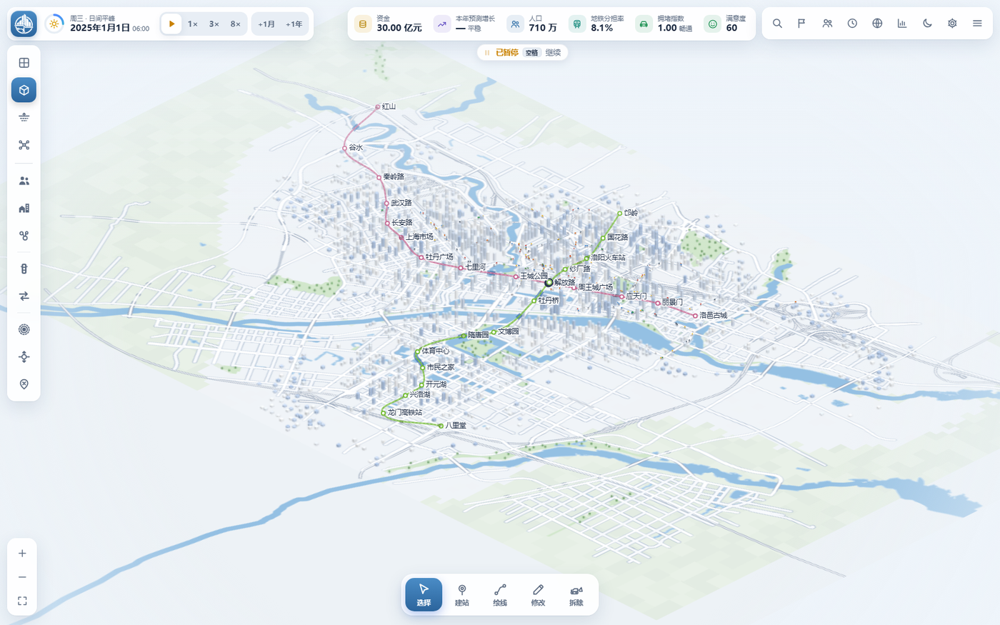
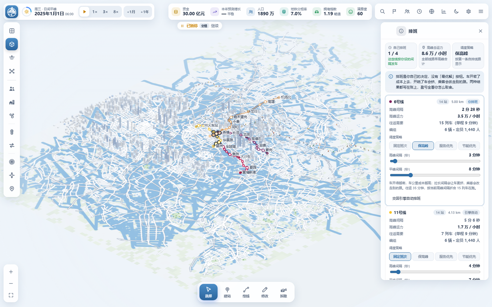
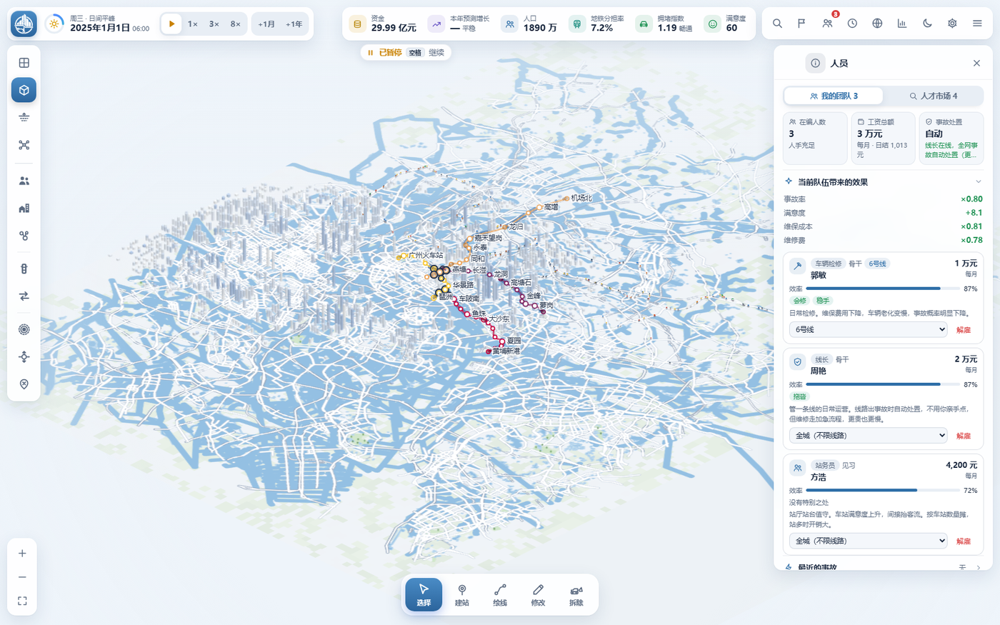
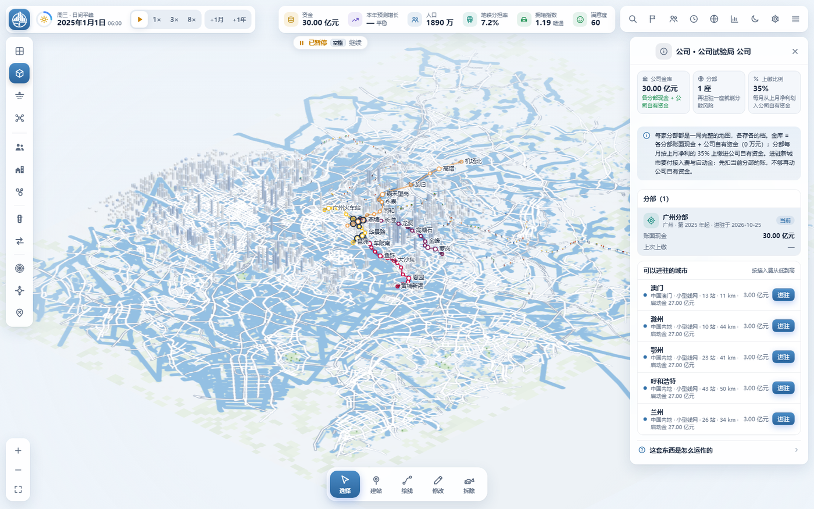

# 城市与地铁

**在真实城市里，运营你自己的地铁。**

54 座中国城市的 2025 年线网已经铺在地图上：从唯一入门图温州开始战役，只接管一小段既有线路；重排班次、雇人、处置事故，把本城人口覆盖率做到 70% 以上再解锁下一城。《城市与地铁》是一款跑在浏览器里的单人地铁经营游戏——线路怎么走、车多久来、雇谁不雇谁、票价定多少，都由你决定。

[在线游玩](https://city-and-metro-cp2.pages.dev/) · [运行与存档](#运行与存档) · [城市](#城市) · [玩法](#玩法) · [操作](#操作) · [底座与署名](#底座与署名) · [非商业使用许可](./LICENSE.txt)

当前版本 **v3.10.0**（2026-10-28）。发布记录见[部署说明](./部署说明.md)，移植细节与数据管线见[独有玩法与数据管线](./docs/独有玩法与数据管线.md)。

> **本仓库是 [VinsonFung/city-and-metro](https://github.com/VinsonFung/city-and-metro) 的非官方修改版。** 底座为 v2.0.0（commit `4102340`，2026-10-22），原作者 **VinsonFung**，版权归原作者所有。本修改版由 [nanji0710/city-and-metro](https://github.com/nanji0710/city-and-metro) 维护，不是官方发布，也不代表原作者意见。具体改了什么见[底座与署名](#底座与署名)。

- **54 座城市，2025 年的真实线网。** 每座城市都只接管**一条真实线路的前 4 站**（线路不足 4 站的城市按实际站数，如清远 3 站；合计 54 条线、215 座车站），按真实经纬度铺在城市底图上；各城 2025 年完整线网的规模标在城市卡片上（54 城合计 397 条线、7836 座车站、约 13 442 km），作为扩张的参照。从北京到清远，用同一套规则计算客流与成本。
- **全国战略地图。** 54 城按真实经纬度落在同一张中国地图上；地图随浅色/深色主题重绘。拖动、滚轮缩放，低缩放聚合邻近城市，放大后拆成单个城市点。支持搜索、省份/状态筛选与定位当前城市。点击城市查看特性、开通费、启动金与验收目标，进入本地经营地图。
- **公司账本可备份、可审计。** 公司池、解锁状态和分部列表可导出/导入；公司面板汇总各分部近 12 个月真实现金流与上缴；多分部月结有实时进度条。
- **温州就是新手教程。** 首局只开放温州，教程围绕 1 号线、扩建 3 站、第一份公司合同和公司池展开；完成后直接进入全国地图。旧青湾教程地图保留为隐藏历史存档，不再出现在新地图列表。
- **班次由你排。** 每条线两个滑块：高峰间隔与平峰间隔，再加一条调度策略。开得密，车公里成本与电费一起涨；开得疏，站台先挤起来，票款和满意度跟着掉。
- **人手由你配。** 6 类岗位、5 个等级、14 种特性；线长能替他管的那条线自动处置事故，其余岗位给全城加成，工资按日结算。
- **事故由你处置。** 单列车故障、区间中断、整线降速、枢纽瘫痪四级，手动处置便宜但要你亲手点，自动处置顺手但更贵更慢。
- **四档难度，一层战役。** 难度改变启动资金、拨款、客流、事故频率与建设成本；战役只开放温州一张入门图，接管一条真实线路的前 4 站；其余 53 城靠「70% 覆盖率 + 手动解锁」逐城推进，覆盖率越高下一城启动金越多。
- **54 城各有轻量特性。** 行政中心、港城外向、历史文旅、工业通勤、山河地形、铁路枢纽、水网都会、科教新城八类偏置，分别影响客流、建设成本与任务奖励。
- **重点城市有真实锚点。** 广州天河体育中心、洛阳博物馆、芜湖方特、温州江心屿、兰州中山桥都进入设施、客流与任务系统，不是只写在卡片上的文案。
- **看得见、听得见的城市。** 2D、2.5D 与地下视图，列车进站开门、乘客上下车，街头车辆与行人随时段变化，列车音效与环境声随镜头改变。

## 真实城市，真实线网

2025 年的洛阳：真实道路、水系、铁路与片区边界来自 OpenStreetMap；战役开局只保留 1 号线的前 4 站，其余线网由你规划。你要决定它是赚钱还是赔钱。

## 班次在你手上

面板里每条线有两个滑块——高峰间隔与平峰间隔——再加一条调度策略，读数会跟着间隔实时算出运力、往返需要的列车数与编组。

## 雇人，然后放手

人才市场每月换一批人。雇一个线长挂到线上，那条线的事故他会自动处置，代价是更贵更慢；其余岗位给全城加成。超过八个人之后，效率开始互相稀释。

## 从一座城到一家公司

已进驻的广州分部、公司池与上缴比例，以及下一批可解锁或可开始的城市。每家分部独立记账，按月把净结余的一部分上缴，用来支付开通费或向当前分部注资。

## 运行与存档

在线游玩：<https://city-and-metro-cp2.pages.dev/>。也可以下载仓库，用桌面版 Chrome / Edge / Firefox 打开 `index.html`，无需安装或构建。

进度保存在当前浏览器本地，不需要账号。自动保存、手动保存（12 个档位）与 JSON 导入导出都支持；换电脑、换浏览器或换网址前先导出备份。各城进度独立，存档可在列表里改名。

## 城市

54 座城市的可玩开局线网合计 54 条线、215 座车站：每城只接管站数最多的那条真实线路的前 4 站（线路不足 4 站按实际站数，如清远 3 站），全部按 2025 年真实走向与经纬度铺设；各城完整线网的规模标在城市卡片上；54 城合计 397 条线、7836 座车站、约 13 442 km。新地图列表只列这 54 城；旧青湾教程地图保留为隐藏历史地图，仅供旧存档读取。

「规模」是城市自身的等级，决定开通费与市政府启动金；开局线网统一为 4 站，与规模无关。它与开局时选的难度是两件事。

| 规模 | 城市 | 开局 | 市政府启动金 |
| --- | --- | --- | --- |
| 特大城市（13） | 北京 · 上海 · 广州 · 深圳 · 成都 · 重庆 · 杭州 · 南京 · 青岛 · 苏州 · 武汉 · 西安 · 郑州 | 1 条线 · 4 站 | 15 亿 |
| 大型城市（13） | 长春 · 长沙 · 大连 · 佛山 · 福州 · 合肥 · 香港 · 济南 · 昆明 · 宁波 · 沈阳 · 天津 · 厦门 | 1 条线 · 4 站 | 12 亿 |
| 中型城市（13） | 常州 · 东莞 · 贵阳 · 哈尔滨 · 金华 · 南昌 · 南宁 · 石家庄 · 温州 · 无锡 · 咸阳 · 许昌 · 徐州 | 1 条线 · 4 站 | 10 亿 |
| 小型城市（15） | 澳门 · 滁州 · 鄂州 · 呼和浩特 · 兰州 · 洛阳 · 南通 · 清远 · 绍兴 · 太原 · 台州 · 芜湖 · 乌鲁木齐 · 湘潭 · 资阳 | 1 条线 · 3~4 站 | 8 亿 |

人口、设施与土地利用由 OpenStreetMap 的地名与兴趣点推算，是模拟值，不是官方统计。

## 玩法

### 线网与建设

规划先进入草案，确认后立即建成运营。地下、地面与高架各有成本、坡度与保护限制；普通建筑拆迁计费，保护建筑不能拆除。城市道路与新区由系统发展，后来的真实地铁不会自动出现。

### 排班与调度

每条线有两个滑块——高峰间隔与平峰间隔——和一条策略：固定班次、保高峰、服务优先、节能优先。间隔直接决定运力与车公里成本。

本作不单独买车：编组由沿线最小的那座车站决定，列车数按周转时间折算。不手动排班时，引擎按站数与站距给一套基准班次，盈亏照样算在你头上。

### 人员

六类岗位：线长、行车调度、列车司机、车辆检修、站务员、客运商业。五个等级（见习 / 熟练 / 资深 / 骨干 / 专家）、十四种特性，同类特性递减。

调度与司机缩短事故影响时长，检修压低维保与维修费，站务提满意度，商业提票款与广告。线长可以挂到某条线上，那条线的事故自动处置；不挂线的岗位给全城加成。工资按日结算，直接进运营成本。

### 事故

四级：单列车故障、区间中断、整线降速、枢纽瘫痪。事故会压低运力、延误时刻、扣满意度。

处置方式分手动（0.75 倍维修费，要你自己点）与自动（1.35 倍维修费、影响时间 1.5 倍，但不用你管）。线网越大、车越多，事故越密。

### 财政

开局给一笔固定启动资金，之后没有白拿的钱：每月财政拨款按**上月运营成本**封顶 1.35 倍，不开车就没有拨款。

收入是票款与财政拨款，支出是车公里成本、车站日常费用、人员工资与债券本息。资金转负并持续到期限就算失败。

### 难度

四档：见习调度、标准运营、白手起家、硬核闯关。分别调整启动资金（1.8× / 1.0× / 0.62× / 0.4×）、拨款（1.25× / 1.0× / 0.85× / 0.7×）、客流（1.10× / 1.0× / 0.92× / 0.85×）、事故频率（0.6× / 1.0× / 1.35× / 1.7×）与建设成本（0.9× / 1.0× / 1.12× / 1.28×）。

运营成本不乘难度系数——算得对就该赚，算错就该亏。

### 战役与公司解锁

战役从唯一入门图温州开始：只保留一条真实线路的前 4 站，建议难度为「见习调度」。其余 53 城默认锁定，包括广州；解锁靠「覆盖率」，不靠大额资金。

公司初始池 5 亿。温州有一份「第一份公司合同」：在起点城新增 3 站，公司池一次性奖励 7 亿。解锁规则只看**地铁人口覆盖率**（步行 15 分钟可达站点的人口占比，真实步行网络计算）：

- 任一已进驻分部覆盖率达到门槛（**入门城温州 50%，其余城市 70%**），才获得 **1 次**解锁机会（每座分部只能贡献一次）；
- 从 70% 起每再多 **2 个百分点**，新分部启动金 **+1 亿**（8/10/12/15 亿基础 + 加成）；
- **解锁必须玩家手动确认**；加成在解锁那一刻按来源分部当时的覆盖率结算并写入公司记录，之后来源分部再涨覆盖率也不会改变已结算的启动金；
- 公司池只付 0.5~1.6 亿开通费，启动金由市政府资本金注入，不从池扣——赚钱的第一用途是把自己城市的线网建完。

每座分部城市还有 **3~5 段阶段合同**：2~4 个站数段把线网逐段推向验收线，末段要求满意度 ≥ 60 连续 2 个月；奖励（启动金的 10%~30%）发到本城现金，HUD 目标胶囊和公司面板常驻进度。满意度胶囊会直接显示下滑主因与车厢拥挤比例，不用翻详情页。自由建造模式仍可选择全部地图，不参与锁图与破产。公司面板会显示下次月结预计上缴，以及净结余为负/低于储备金时为什么不上缴。其它分部会在当前分部月结后自动补结算，分部卡片的「上次上缴」是真实月结记录；公司面板还有近 12 个月的全公司月报。多分部结算会显示实时进度条，100% 后继续当前城市时间。

### 多城公司

一家公司下挂多个分部，每个分部是一局完整地图。

分部每月把上月**净结余（含拨款结余）的 20%** 上缴公司池，**80% 留在本地**；本地现金不能跨城使用。公司池可以向当前分部注资：发展注资上限为过去 12 个月正利润的 50%，紧急救援上限为 3 个月运营成本；资金失败可以在失败页直接救援。公司池和所有分部都停运时进入战役破产。

### 任务与目标

54 城每城按地图档位有 **4 / 6 / 8 / 10 个城市任务**：覆盖率、日均与工作日客流、票款覆盖、片区补盲、设施接驳、车站拥挤、片区拥堵、连接主要城区。开局一年后每 6 个月尝试发布一个，最多同时 2 个；已完成或失败的任务不会重复。目标值按发布当月的实际覆盖、客流与拥堵计算，避免任务一出现就已经完成。

任务生成时还会检查可完成性：连接任务的锚点必须能建站，设施接驳必须在设施附近找得到可建站的位置，片区任务必须有足够的可建设陆地，车站拥挤任务优先选还能扩建的 S/M 站，而不会把 L 站选成“升级即可解决”的目标。

## 操作

| 操作 | 方式 |
| --- | --- |
| 平移 / 缩放 | 左键拖动、WASD / 方向键；滚轮、`+` / `−` |
| 工具 | `V` 选择 · `B` 建站 · `L` 绘线 · `E` 修改 · `X` 拆除 |
| 绘线 | 依次点击；`Shift` + 点击加转弯点；点首站闭环；右键 / `Enter` 结束绘线 |
| 延长 / 支线 | 选中线路拖动端点「+」；中间站从详情进入支线绘制 |
| 批量修改 | 选择 / 修改工具中按住 `Ctrl` 或 `Shift` 多选 |
| 草案 | `Ctrl+Z` 撤销，`Ctrl+Y` 重做；`Ctrl+Enter` 确认建设 |
| 时间 | `空格` 暂停 / 继续，`1` / `2` / `3` 对应 1× / 3× / 8×；按钮推进一月 / 一年 |
| 视图 | `T` 切换 2D / 2.5D，`U` 地下，`K` 线网图，`F` 全图 |
| 跟随 | 选择工具点击可见列车；`H` 收起界面；`Esc` 或拖动退出 |
| 常用入口 | `/` 搜索，`G` 统计，`N` 主题，`M` 声音；`Esc` 关闭或返回 |

顶栏另有四个按钮：**任务**、**人员**、**排班**、**公司**。新局、读档与跳跃推进后默认暂停。触屏支持拖动、双指缩放与底部详情抽屉，桌面浏览器仍是主要使用环境。

## 开发文档

| 文档 / 入口 | 用途 |
| --- | --- |
| [PRD](./PRD.md) | 当前玩法、交互、兼容与验收要求 |
| [地图设计指南](./地图设计指南.md) | 地图选区、数据、历史、经营校准与接入标准 |
| [独有玩法与数据管线](./docs/独有玩法与数据管线.md) | 本修改版新增的五套玩法、数据来源与验证矩阵 |
| [部署说明](./部署说明.md) | Cloudflare 原生 GitHub 部署、发布记录与实际验证范围 |
| [js/news.js](./js/news.js) | 游戏内面向玩家的更新公告 |
| [js/maps.js](./js/maps.js) / [js/config.js](./js/config.js) | 地图登记与共用参数 |

运行资源位于 `index.html`、`css/`、`js/`、`img/`；各城场景使用 `data_*.js`，54 城地理使用 `geo_*.js` 并在选中地图时按需加载，基底五图随首屏加载。执行 `node scripts/build.mjs` 生成发布目录 `dist/`，不需要依赖安装。

验证脚本：`node tools/simcheck.mjs`（引擎断言）、`node tools/smoke-cities.mjs`（54 城逐个开局）、`node tools/audit.mjs`（记账恒等式与数值体检）、`node tools/shoot.mjs <场景>`（截图与 console 报错检查）。

## 已知边界

- 地理使用现代 OpenStreetMap 骨架；人口、设施规模、经济与普通建筑为估算或模拟，不是官方统计。
- 可玩线网是抽样。城市卡片上写的「29 条线 · 542 座站」是该城市 2025 年的真实规模，可玩的开局线网按网格与性能上限抽成普通城市 4 条、广州 5 条、入门图温州 1 条线的前 4 站、每条最多 14 站，两者不是一回事。
- 54 城按 2025 年现状开局，不逐年开放新区、不模拟填海；没有逐城历史任务与地标；每城有 4-10 个按地图档位生成的城市任务，另有按本局状态生成的通用动态任务；币种统一人民币，建设、运营与票价沿用基底参数。
- 54 城底图按选图懒加载：首屏只加载全国战略图数据；进入某座城市时才载入该城 `geo_*.js`，未载入城市的列表缩略图先显示占位图。
- 公司层与战役解锁记录保存在浏览器本地，不随单局存档导出；换设备时各城存档可以导出，但公司金库、分部列表与已解锁地图不会迁移。
- 模拟汽车、地铁、步行接驳与换乘；不经营公交与普通铁路，没有多人或云存档。
- 旧版 v1.0 示意地图存档不兼容。支持升级的旧档在升级前自动备份；地图版本、尺寸或格式不兼容时拒绝载入。
- 自动渲染细节随负载调整，画面对象为代表性展示。合成声音在首次交互后播放，可分别调节总音量、列车音效与城市环境音。

## 底座与署名

- 底座项目：[VinsonFung/city-and-metro](https://github.com/VinsonFung/city-and-metro)，v2.0.0，commit `4102340`（2026-10-22）。
- 原作者与版权人：**VinsonFung**。游戏引擎、渲染、界面外壳与地图数据管线由原作者完成。
- 本修改版：[nanji0710/city-and-metro](https://github.com/nanji0710/city-and-metro)，非官方分支，不代表原作者，也不是原作者的发布渠道。
- 主要修改（完整差异见 git 历史）：新增 54 座中国城市的 2025 年线网与地理数据；新增人员雇佣、突发事件、四档难度、发车间隔排班与多城公司层；财政拨款改为按上月运营成本封顶；移除年代筛选，统一 2025 年开局。
- 许可证、版权声明与第三方署名按原许可第 2 条完整保留，逐项列在 [THIRD_PARTY_NOTICES.txt](./THIRD_PARTY_NOTICES.txt)。

## 版权与许可

**Copyright © 2026 VinsonFung。保留所有权利，禁止商业使用。**

公开仓库仅允许非商业学习、研究与游玩。收费、广告变现、商业产品、服务或分发均不在授权范围内，修改或改名不构成例外。具体见 [LICENSE.txt](./LICENSE.txt)。OpenStreetMap 地理数据遵循 ODbL 1.0，见[第三方许可说明](./THIRD_PARTY_NOTICES.txt)。
